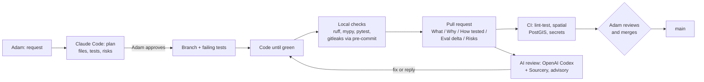

# Detour

An AI road-trip planner that mixes hotel nights with outdoor host-style stops (wineries, farms, breweries, museums) along one corridor: Washington, DC → Shenandoah / Skyline Drive → Blue Ridge Parkway → Asheville, NC.

> **Unofficial proof of concept.** Not affiliated with or endorsed by Choice Hotels International or Harvest Hosts. No logos or trademarks are used as branding.
>
> **Sample data.** All hotels and stops are a hand-curated sample from public pages, with a source URL on every row. Prices and points are sample values, not live rates.
>
> **Example host-style stops.** Places are shown as examples of the kind of stop a host network offers. We never claim that any business is a Harvest Hosts member.
>
> **Road data.** Town coordinates come from OpenStreetMap Nominatim and the route from the OSRM demo server (car profile, no traffic), fetched once and cached in `db/seed/corridor_route.geojson`. Map data © OpenStreetMap contributors (ODbL).
>
> **Road conditions are not reflected.** Closures (including Hurricane Helene-related Blue Ridge Parkway closures) and seasonal closures are not modelled. The route uses towns as waypoints (Front Royal, Luray, Staunton, Roanoke, Boone, Asheville), not Parkway segments, so drive times follow town-to-town roads.

**Status:** Day 1 of 4 (kickoff). Nothing runnable yet.

## Why

In 2026 Choice Hotels agreed to acquire Harvest Hosts, an RV network of 11,200+ host locations [S1], which isn't yet part of Choice Privileges [S2]. Choice's 2026 AI launches mostly serve hotel owners [S3], and commentators have asked who is building AI for the guest [S4]. Detour tests a bet: a planner that adds hotel nights where they make sense turns outdoor travelers into hotel guests, while car travelers discover host-style places as daytime stops and still sleep at hotels.

Sources: [`docs/context-sources.md`](docs/context-sources.md).

## Run the demo
```
uv sync
uv run python -m agent.server --sample      # no AWS: replays a validated sample plan
```
Open http://127.0.0.1:8000. For live plans from OpenAI GPT-6 Luna (ADR-007), put
`OPENAI_API_KEY=...` in `.env` and run:
```
uv run --env-file .env python -m agent.server
```
With `DATABASE_URL` set, searches use PostGIS and every run is saved to `trips`; without it,
the seed CSVs are searched in memory. Rate limit: 10 plans per IP per hour.

## Docs

- [Spec (v0.3)](docs/spec.md): source of truth
- [ADRs](docs/adr/): 001 agent stack · 002 database and routing · 003 spatial search · 004 evals, merge gate, tracing · 005 web app, map, web↔agent API · 006 database migrations
- [Plans](docs/plans/)
- [AI review checklist](docs/review-checklist.md)
- [CLAUDE.md](CLAUDE.md): rules for AI-assisted work in this repo

## How this was built

Detour was built in 4 days by Adam working with Claude Code as the coding agent, under the
rules in [CLAUDE.md](CLAUDE.md): plan before code, one small branch per change, tests first
for deterministic logic, an ADR for every decision, and Adam decides and merges.

### Pipeline


Guardrails that ran on every change:
- **Claude Code hooks** (`.claude/settings.json`): block edits to `.env*` and to migrations
  already on `main`; run the unit tests after every edit under `agent/`.
- **Branch protection** on `main`: pull requests only; `lint-test`, `spatial` and `secrets`
  must pass; no force pushes.
- **AI review** on `pull_request_target` with a trusted-base checkout, a read-only sandbox and
  a pinned action ([ADR-004](docs/adr/004-evals-merge-gate-and-tracing.md)).

### What the agent can and can't do
The planner (OpenAI GPT-6 Luna, [ADR-007](docs/adr/007-agent-loop-bedrock-converse.md)) only
chooses places from tool results and writes the words. Drive times, distances and costs are
filled in by code from the same functions `validate_plan` checks, and a plan is returned only
after `validate_plan` passes, with every ID checked against the IDs the tools returned in that
run. The eval suite (20 cases, `evals/`) gates schema and grounding at 100% and the travel
rules at 95%.

### Decisions where Adam overrode or redirected the AI
- **Data realism over convenience.** Prices were sampled one hotel at a time from the
  brand's public search for a single night, not estimated. RV host stops come from each
  host's own site or Hipcamp listing; Harvest Hosts listings were ruled out.
- **AI reviewer.** The ADR drafted a Claude-based reviewer; Adam chose OpenAI Codex
  (spec v0.3).
- **Agent framework.** ADR-001 chose Strands; on the final day Adam chose a small
  Converse loop that can be tested offline (ADR-007).
- **Scope cuts** (spec v0.4): no AgentCore and no Vercel deploy; a local demo page instead.

### Examples from the PR history
- [#10](https://github.com/adam1241/Detour/pull/10) `validate_plan`: written tests-first; review
  rounds added per-violation acknowledgement and exact totals.
- [#11](https://github.com/adam1241/Detour/pull/11) evals: a follow-up commit closed gaps
  reviewers found (vehicle, structure, answering the request that was actually asked).
- [#8](https://github.com/adam1241/Detour/pull/8) and
  [#13](https://github.com/adam1241/Detour/pull/13) were merged into a stacked branch instead of
  `main`; #9 and #14 re-landed them. Stacked PRs are no longer used.

### Not done yet (honest status)
- Evals don't run in CI yet: the runner works locally (`python -m evals.runner`), and the
  baseline `evals/results/main.json` is recorded after the first live run.
- Bedrock is wired but blocked for Anthropic models on our AWS account, so the planner runs on
  OpenAI for now (ADR-007 amendment).


**Merge process, stated openly:** branch protection requires pull requests and passing status checks (CI, plus evals when the agent, prompts or evals change), but **not** an approving review. GitHub doesn't let a PR author approve their own PR, and Adam is the only human on the project. Adam is the only one who merges and leaves a written review comment on every PR. The AI code review (OpenAI Codex) is advisory. See [ADR-004](docs/adr/004-evals-merge-gate-and-tracing.md).
